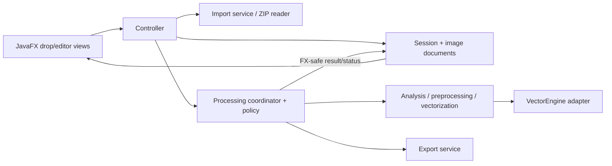
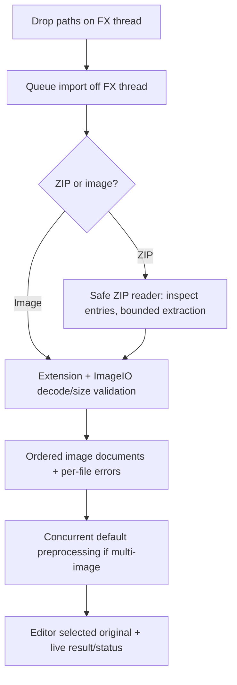
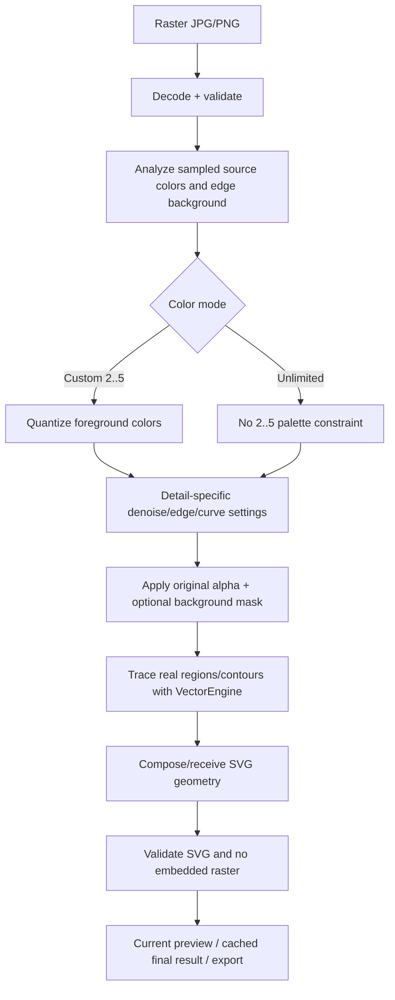
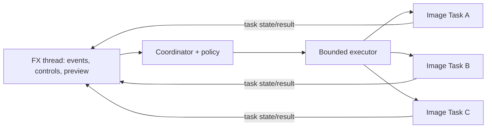

# Architecture and student implementation plan

This document describes the **target architecture** of the intentionally incomplete student Maven project. The sibling `complete-reference/` preserves a working version but is not an automatic code source: copying its implementation requires explicit user authorization. Requirement IDs refer to `REQUIREMENTS.md`. Decisions remain provisional where lecturer wording is ambiguous; student TODOs implement the contracts described here.

## 1. Overview and technology

Use a small MVC-inspired desktop structure: programmatic JavaFX views present state, controllers translate UI actions into operations, model objects hold each image's settings/status/results, services handle import and conversion, and one adapter isolates external tracing. A coordinator owns asynchronous work and the graded processing rule. No dependency-injection framework or repository/database layer is needed.



**Foundation scaffold:** The Maven wrapper, module, and `Launcher` remain. `pom.xml` uses compiler release **21**, JavaFX controls/web **21.0.6**, JUnit Jupiter **5.12.1**, Surefire **3.5.2**, and JavaFX Maven plugin **0.0.8**. The unused FXML hello files were removed; `Launcher` and the plugin launch `VectorizeApplication`. Set the IntelliJ project SDK and Maven runner to **JDK 21**; the terminal default JDK 26 distribution lacks `jdk.jsobject` needed for these `javafx-web` tests. Skeleton compilation is verified, not functionality. [OpenJFX JavaFX 20 highlights](https://openjfx.io/highlights/20/), [JavaFX 21 highlights](https://openjfx.io/highlights/21/).

**Technology plan:** Set `JAVA_HOME`/IntelliJ SDK to JDK 21. `./mvnw -DskipTests package` checks skeleton compilation; acceptance tests intentionally fail until TODOs are completed. `./mvnw javafx:run` throws immediately from `VectorizeView`'s constructor until Phase 2's screen layout is implemented; it displays the drop layout only after that, and still has no completed handlers or tracing until later phases. The adapter is only a contract: before installing/using AutoTrace on any target machine, verify color paths, transparency, failure behavior and licensing; an external executable is not supplied by Maven/jlink. Standard Java `ImageIO`, `java.util.zip`, XML parsers, `ExecutorService`, JavaFX `Task` and `DirectoryChooser` are recommended facilities. [DirectoryChooser API](https://openjfx.io/javadoc/21/javafx.graphics/javafx/stage/DirectoryChooser.html).

## 2. Packages and responsibilities

The scaffold is intentionally compact. There is one view and one controller because the drop zone transitions within one desktop application; separate screen controllers are unnecessary.

```text
src/main/java/se233/vectorize/
  Launcher.java, VectorizeApplication.java
  model/        ImageDocument, VectorizationSettings, DetailLevel,
                ColorMode, ProcessingStatus, AppSession
  view/         VectorizeView
  controller/   VectorizeController
  service/      ImageImportService, ZipImportService, ColorAnalysisService,
                BackgroundRemovalService, RasterPreprocessor,
                VectorizationService, SvgValidationService, ExportService,
                PresetService
  adapter/      VectorEngine, AutoTraceVectorEngine
  concurrency/  ProcessingCoordinator, ProcessingPolicy
  exception/    ConversionException (typed category/cause)
src/main/resources/se233/vectorize/app.css
src/test/java/se233/vectorize/...  (behavioral and integration tests)
```

Do not create separate interfaces for each service. `VectorEngine` is the one justified interface: it prevents controllers/pipeline/export from knowing CLI commands. A small typed exception or error-category enum is enough; avoid an exception class per failure. A preview result can be an immutable SVG payload/validated file reference plus source/settings/engine signature, not a JavaFX `Node` stored in the domain model.

| Component | Responsibility | Traces |
| --- | --- | --- |
| `AppSession` + `ImageDocument` | Ordered import list, selected index, per-image settings, palette summary, preview/final signature, status/error | FR-006, FR-012, FR-021 |
| `VectorizeView`/`VectorizeController` | Drop/setting/navigation/zoom/export gestures; bind UI state; call services/coordinator | FR-001, FR-004–FR-016 |
| Import + ZIP services | Input classification, safe extraction, decode/validation, stable order | FR-001–FR-003, NFR-004 |
| Color analysis + raster preprocessor | Sample palette, Custom quantization, detail transforms, background mask | FR-007–FR-011, FR-013 |
| Vectorization + SVG validation | Pipeline orchestration, engine invocation, reject invalid/raster-only SVG | FR-017, FR-018, NFR-005 |
| `VectorEngine` adapter | Engine-specific input format, CLI/process options, timeout/output/error capture | FR-018 |
| Processing coordinator/policy | One-shot background tasks, batch scheduling, progress, stale-result guard, cancellation | FR-010, FR-012–FR-014, NFR-001–NFR-002 |
| Export service | Unique filename mapping, final-result reuse/processing, SVG validation and writes | FR-015–FR-017 |

## 3. Domain and settings state

`DetailLevel {LOW, MEDIUM, HIGH}` and `ColorMode {UNLIMITED, CUSTOM}` make illegal textual states less likely. Immutable `VectorizationSettings` contains detail, color mode, Custom count (2–5, default 2), and remove-background boolean. The count remains stored when Unlimited is selected but is ignored until Custom returns. Validate settings in one place. `ProcessingStatus` distinguishes `QUEUED`, `RUNNING`, `READY`, `FAILED`, and `CANCELLED` (plus not-started if useful).

Each `ImageDocument` has stable ID/display name/source path (direct or managed temporary extract), analyzed palette summary, current settings, latest validated SVG, result settings/source-file version/pipeline version, task generation, and status/progress/error. `AppSession` owns the ordered list and selected index. JavaFX `ImageView`/`WebView` nodes stay in `VectorizeView`, never in the model. Heavy decoded rasters are released after processing; originals load through JavaFX's background image loading.

**Settings interpretation:** global defaults initialize each document; after import, settings belong to each image. Back/Next thus restores edits and the matching result; Export All uses every image's current settings. This is simpler and more predictable than a mutable global switch that silently invalidates all previews. The graded multi-drop default makes all initial documents Medium/Custom/2. Record this as a decision because the brief does not specify settings scope. A future “Apply to all” control would be optional, not a hidden assumption.

Cache validity for export is `source size/last-modified version + immutable settings + pipeline version`; `ExportService` rechecks the file version on a worker and reprocesses if it changed. Preview state matches settings/generation; an externally changed source is not monitored live until an export or refresh, which is a practical limitation. Any setting change invalidates that document's previous result. Preview runs get a monotonically increasing generation; completion updates the document only if generation/settings still match. Navigation does not change an image's generation. (FR-006, FR-010, FR-021)

## 4. Import and ZIP pipelines



The FX handler only checks that dropped paths exist and asks the import service to run. Decode to confirm bytes actually form JPG/PNG; extension alone is not proof. A corrupt individual file is recorded and valid siblings continue. Transition to editor once at least one valid document exists; show import/processing progress. Direct import and extracted ZIP entries use the same document creation path. (FR-001–FR-003, FR-012)

`ZipImportService` uses `ZipFile` to reject malformed archives, iterates entries, skips directories/unsupported extensions, rejects absolute, drive-prefixed, `..`, and escaping paths, and checks extracted CRCs. It bounds entry count (**500**), each expanded entry (**40 MB**), and total expanded bytes (**200 MB**); image decoding is limited to **25 megapixels**. Entry size metadata is not trusted during copying. Each image is flattened into a safe unique temp filename; supported files then use the direct-image validation path. Managed temporary extracts are removed after workers stop. ZIP Slip and oversized ZIPs are rejected with user-safe feedback. (FR-002, NFR-003–NFR-004)

## 5. Conversion and preview pipelines



On import, multi-image preprocessing schedules the entire default conversion path for each usable document: source decode, color detection, Medium/Custom/2 quantization, tracing, and validated preview. The first selected document appears immediately with original and a processing indicator; each preview replaces its indicator on completion. A single-image import uses the same asynchronous pipeline without the parallel rubric condition. Each setting change cancels the prior preview task and schedules a new one-shot task immediately; generation matching ensures the newest configuration wins. “Instant” means immediate UI reaction and current-result scheduling, not synchronous tracing. (FR-010, FR-013)

**Detail design TODO:** In Phase 4, choose progressively stronger raster resolution and/or curve-tolerance settings for Low, Medium and High, then verify visibly different SVGs on the same fixture. Detail must be an output parameter, not merely a label; avoid promising a particular aesthetic result for every photograph. Record selected numeric knobs and test them before treating them as stable. (FR-007)

**Real vector gate TODO:** `SvgValidationService` should require an SVG namespace/root, useful dimensions and nonempty vector geometry; reject raster `image`, script, `foreignObject`, data-image or external links and disallow DTD/external XML entities. A successful CLI exit alone is insufficient. Pass the **same validated SVG** to FX-thread-only WebView for preview and Export All; disable WebEngine JavaScript. Original uses background-loaded JavaFX `ImageView`. Zoom In/Out/Fit should operate on the vector preview; original remains fitted to its pane. Existing snapshot tests are acceptance targets, not evidence that skeleton preview works. [WebView API](https://openjfx.io/javadoc/21/javafx.web/javafx/scene/web/WebView.html), [WebEngine API](https://openjfx.io/javadoc/21/javafx.web/javafx/scene/web/WebEngine.html). (FR-004, FR-005, FR-017, NFR-005)

## 6. Color analysis and quantization

Analyze a bounded, spatially distributed sample of decoded pixels in a consistent color space; separate transparent pixels and likely background before foreground palette estimation. A frequency/color-distance summary detects meaningful colors for the UI and seeds the Custom palette. “Detected colors” means representative clusters, not enumerating every JPEG compression shade. Start Custom at 2. If only one meaningful foreground color exists, preserve the 2 default in settings but explain/handle that a second distinct color may not exist; do not invent a false color. Never offer >5. Exact significance threshold needs visual fixtures. (FR-009)

| Approach | Strength | Cost / weakness for this pair | Recommendation |
| --- | --- | --- | --- |
| K-means | Often good representative colors; fixed target 2–5 | Iterative convergence, seed sensitivity, empty clusters, color-space tuning; needs deterministic initialization for repeatable previews | Good alternative if Median Cut quality is poor |
| Median Cut | Deterministic, simple histogram/box splitting, naturally yields 2–5 palette buckets; easy to test/explain | Can overrepresent rare outliers; box splitting in RGB is not perceptually ideal | **First implementation choice**, with sampled histogram and optional near-color merge |
| Octree | Streaming/bounded palette building; efficient on large images | Tree/pruning bookkeeping and order-dependent quality add complexity without value at only five colors | Defer |

**Median Cut implementation TODO:** Bound and spatially distribute foreground sampling, build a repeatable weighted color summary, partition it into at most 2–5 representative clusters, and map Custom pixels to chosen representatives. Detected swatches should derive from the same analysis. Unlimited must bypass the 2–5 reduction while still allowing the tracer's inherent approximation. Choose and document sample/quality thresholds after testing gradient, band and photograph fixtures; keep this contract independent of AutoTrace CLI color-count options. (FR-008–FR-010)

## 7. Background removal

**Background TODO:** Preserve PNG alpha in a mask even without the checkbox. For opaque JPG/PNG with removal selected, estimate a plausible border background on the **decoded raster before quantization**, then consider edge-connected flood fill rather than removing every globally matching pixel. A busy border may be ambiguous; report limitations instead of claiming photographic subject segmentation. Represent masked pixels distinctly so the engine can omit their paths and leave SVG canvas transparent. Draw a checkerboard behind the preview. Test soft edges, textured backgrounds and foreground touching the border. (FR-011)

## 8. Engine boundary and choice

`VectorEngine` accepts an immutable prepared PNG path, `VectorizationSettings`, ignored-background color, and cancellation supplier; it returns SVG text or a typed failure. The adapter owns executable discovery, a fixed argument list (never concatenate filenames into a shell), bounded runtime, combined-output logging, process exit checking, temporary output cleanup, and process termination on cancel. `VectorizationService` owns palette/background/detail preparation and SVG validation, so replacing the CLI does not rewrite UI/export. (FR-018)

**Engine implementation TODO:** The scaffold retains `VectorEngine` and an empty AutoTrace adapter. Decode JPG/PNG in the application and pass a prepared PNG so tracing does not depend on an optional JPEG decoder. Verify genuine colored SVG paths and missing-background behavior. Prior feasibility work found that some AutoTrace `-color-count`/`-background-color` combinations could return an **empty SVG with exit 0**; do not trust CLI count or exit alone. Own Custom reduction in the preprocessing service and validate every result. The adapter must check executable/process errors, timeout, cancellation, output and cleanup. Potrace remains a replaceable alternative but traces two-valued masks and would require color layers. Confirm executable distribution and GPL/LGPL obligations before packaging; Maven/jlink will not bundle a native CLI automatically. [AutoTrace project README](https://github.com/autotrace/autotrace), [AutoTrace man page](https://github.com/autotrace/autotrace/blob/master/autotrace.1), [Potrace FAQ](https://potrace.sourceforge.net/faq.html), [Potrace man page](https://potrace.sourceforge.net/potrace.1.html).

## 9. Concurrency, graded policy, and state handoff

Use **one bounded `ExecutorService` + one-shot JavaFX `Task` per image/preview/export job**. The executor limits threads (e.g., `min(4, max(2, availableProcessors - 1))`, measured for memory/tool pressure); do not spawn a thread per file. Task supports observable state, messages, progress, errors, and cooperative cancellation, with state notifications delivered on the FX thread. `Service` is useful for a reusable single operation but adds lifecycle state for one-shot per-image runs; `CompletableFuture` would duplicate Task's FX-observable status and handoff here. Avoid using all mechanisms at once. [JavaFX Task API](https://openjfx.io/javadoc/21/javafx.graphics/javafx/concurrent/Task.html), [JavaFX Service API](https://openjfx.io/javadoc/21/javafx.graphics/javafx/concurrent/Service.html).



**ProcessingPolicy TODO:** Make it the **only** evaluator of the assignment's `imageCount > 1`, `MEDIUM`, `CUSTOM` predicate from a frozen batch/settings snapshot. The controller and export service ask the coordinator to schedule work; neither repeats the condition. The default multi-drop documents should overlap independent decode/analyze/quantize/trace/validate tasks. Nonmatching jobs still run off FX but can be admitted serially. Export invokes the same policy for needed final jobs and independent writes. Never use `parallelStream` from an event handler. Test exact boundary cases. (C-003, FR-013–FR-016)

**Mixed per-image settings:** take a snapshot of all images; eligible Medium/Custom jobs may run concurrently if at least two are eligible, while other jobs run background sequentially. If only one is eligible, there is no meaningful parallel pair. This keeps the graded default exact and makes each image's output respect its own settings, but the lecturer may interpret the condition as batch-wide global settings; confirm before locking policy tests. This special case is centralized in `ProcessingPolicy`, not scattered. (Open question 3)

**Coordinator TODO:** Worker `Task.call()` should handle heavy work from immutable settings/path snapshots. Publish stage messages and coarse per-file progress (decode, prepare, trace, validate/write); aggregate progress counts completed/failed/cancelled jobs honestly. A CLI without internal progress shows the tracing stage rather than a fabricated fine-grained percent. Task listeners update `ImageDocument` only on FX. Individual failures should not cancel siblings; generation checks and Task cancellation prevent stale preview handoff. Footer status is outside the zoom-only top. Cancel Processing should cancel active jobs, and the adapter should destroy running processes; shutdown should stop workers before ZIP temporary cleanup. Scene graph, WebView and chooser stay on FX; ZIP, `ImageIO`, palette, CLI, XML validation and writes stay off it. Test partial failure, cancellation, stale result and bounded threads. (NFR-001–NFR-003)

## 10. Export architecture

**Export TODO:** `VectorizeController` should open `DirectoryChooser` on FX after Export All; `null` means user cancellation. The coordinator snapshots each document's path/settings/cached SVG and uses the same policy for batch scheduling. `ExportService` should check source/pipeline freshness on a worker; stale images need final processing. Reserve unique `.svg` names, validate SVG, write via a temporary file without silent overwrite, and report per-task path/error plus aggregate partial failures. Graded Medium/Custom batches should trace/write concurrently on bounded workers. Verify JPG/PNG files in an external SVG renderer before accepting this phase. (FR-015–FR-017)

## 11. UI design and error handling

Start with a drop view; transition after usable imports. Editor layout: **top only** Zoom In/Out/Fit; center original `ImageView` and current SVG preview side by side; right Detail, Colors/Custom count, Remove Background, Back/Next, Export All. Place filename/index, per-image status, aggregate progress, and recoverable error summary in a footer or within center/right status space, not as extra top controls. Detail and color changes immediately show pending/current generation; a stale result is marked as such or hidden. Navigation restores each document's state. Zoom changes presentation only and never triggers tracing. Remove Background can show checkerboard in preview. Right-pane controls disable only when their action is impossible, with clear reason. (FR-004–FR-016, NFR-007)

Use one `ConversionException` carrying category (`INPUT`, `ZIP`, `ENGINE`, `SVG`, `OUTPUT`, etc.), file/source label, and technical cause. Translate it at the UI boundary into concise action/context (“Could not read photo.jpg: damaged PNG data”; “AutoTrace is unavailable”; “3 of 5 files exported”). Log or retain details for debugging; do not present raw stack traces. Corrupt ZIP, unsafe entry, no supported entries, process timeout/nonzero exit, invalid SVG, inaccessible directory, write failure, and partial batch all have dedicated visible outcomes. A malformed archive may be rejected as a whole; an invalid image entry can fail individually. (FR-003, FR-018, NFR-003)

## 12. Testing and demonstration plan

**Existing tests are acceptance targets, not passing student tests.** Their 20 cases cover policy boundaries, typed settings/default/max, Median Cut versus Unlimited, Low/Medium/High effects, JPG/PNG/alpha/background real tracing, missing executable, invalid/raster-wrapped SVG, ZIP corruption/empty/traversal and partial import, cache freshness, export collision/inaccessible folder, preset validation, individual worker failure, overlapping multi-drop preview/export, navigation, editor SVG rendering/zoom-to-fit, and external SVG opening. Fake `VectorEngine` tests isolate coordination from engine quality. Implement one phase at a time, then run matching tests; `./mvnw -DskipTests package` is the current compile check. Visual artifacts, if generated later, belong in ignored `target/` and need manual review.

Manual rubric demonstration: JPG + PNG/alpha and external SVG open; zoom and Back/Next; visibly distinct detail levels; Unlimited vs Custom 2/5; rapid setting changes with latest preview; background checkerboard; ZIP import; multi-drop default concurrent progress and responsive navigation; parallel Export All, OS chooser, partial failure recovery. Include flat artwork and photographs to expose quantization/tracing quality limitations. Measure responsiveness rather than claiming it. (All rubric areas)

## 13. Additional feature candidates and pair work

| Candidate | Usefulness | Complexity | Advanced Programming / demo value | Architecture effect | Mandatory-work risk |
| --- | --- | --- | --- | --- | --- |
| Named conversion presets (save/load Medium/Custom/etc. settings) | Reuse chosen settings across batches | Low–medium | File I/O, typed serialization/validation, easy live demonstration | Small preset service/dialog; settings model already exists | Low if added after rubric work |
| Interactive before/after comparison overlay | Inspect tracing quality | Medium | JavaFX transforms/clipping, strong visual demo | Additional preview mode, synchronized zoom | Medium; may be mistaken for required side-by-side preview |
| Conversion history with undo/revert settings | Recover experiments | Medium–high | State snapshots/command-style undo, strong OO discussion | History per document; stale tasks/caching more complex | High; distracts from concurrency/export |

**Phase 9 candidate:** `PresetService` and Save/Load controls are scaffolded; persistence and handlers are TODO. A validated `.properties` format and native file chooser would make settings reusable without adding restricted top controls. Confirm with lecturers that presets are significant enough before relying on the extra point. (FR-019)

Pair division: Student A owns import/ZIP safety, domain/settings, color/background preprocessing; Student B owns engine adapter/SVG gate, JavaFX editor/export/concurrency integration. Each reviews the other's contract and tests. Both jointly implement the graded default path and manually demonstrate it; integrate small slices instead of separate unmerged subsystems. Assignments can change by availability, but there should be one owner per contract and shared rubric review.

## 14. Decisions and trade-offs

| ID | Decision | Reason | Alternative considered | Trade-off | Rubric impact |
| --- | --- | --- | --- | --- | --- |
| D-01 | Preserve Maven wrapper/module/Launcher; replace unused FXML hello screen and target JDK 21 | Existing useful project; Java 8 target conflicted with JavaFX 21 | Rebuild from scratch or retain dead hello code | IntelliJ SDK must be set to 21 | Enables stable JavaFX demos |
| D-02 | Shared import defaults, then per-image settings/results | Navigation/export can restore exact image state; default batch remains graded | One mutable global setting | Mixed-setting parallel policy needs definition | Back/Next, preview, export |
| D-03 | One coordinator/policy; default Medium/Custom multi-batch parallel, others background serial | Predicate traceable and testable; never freeze FX | Parallelize all work regardless of configuration | Mixed-setting wording ambiguous; serial may be slower | Preprocessing and export second points |
| D-04 | Bounded executor + one-shot JavaFX Task | Clear FX-safe state/progress and controlled workers | CompletableFuture + `Platform.runLater`; reusable `Service` | Task/coordinator aggregation needs care | Visible concurrency, responsive UX |
| D-05 | Median Cut for Custom palette | Deterministic, small count, easy explanation/test | K-means; Octree | Quality may require later tuning | Custom colors/instant preview |
| D-06 | `VectorEngine` interface and AutoTrace CLI adapter with app-owned Custom quantization | Color-capable tracing; installed AutoTrace's count+background quirk needs isolation | Potrace masks/layering | External executable/licensing and photo quality remain demo constraints | Real JPG/PNG SVG, colors/background |
| D-07 | Validate and preview the same SVG later exported | Prevent raster-wrapped/invalid success and mismatched preview | Trust CLI output | XML/render check costs extra work | Vector format and preview/export |
| D-08 | Edge-connected background candidate before palette reduction | Avoid treating edge foreground of same color as background | Remove dominant palette color globally | Complex photo backgrounds remain hard | Transparent-background point |
| D-09 | Unique export names and partial-success report | Prevent collisions and lost successful work | Silent overwrite or whole-batch abort | Naming/retry semantics should be confirmed | Openable export and UX |

## 15. Open technical questions and implementation order

The protected reference previously demonstrated feasibility on this Mac, but **none of those outcomes is implemented in student/**. The student should independently test intermediate JPG/PNG decoding, Custom/Unlimited, alpha/background, valid paths, WebView display and external SVG opening. Proposed resource limits are 25 megapixels, 500 ZIP entries, 40 MB per entry and 200 MB total expanded bytes; choose and test a finite tracing timeout. Remaining lecturer questions: global versus per-image settings, mixed-setting parallel grading, photo/background and Unlimited quality, any numeric “instant” threshold, preset significance, and native engine distribution/licensing. Mixed image+ZIP drops are an additive interpretation to confirm.

Implement the phases in `AGENTS.md` only when the user's request authorizes them. Before lecturer assessment, run `./mvnw test` and `./mvnw javafx:run` with JDK 21 and a verified native engine, then demonstrate every scenario in `REQUIREMENTS.md` on the grading machine. Visual quality, subjective UX, extra-feature significance and portability cannot be certified by unit tests alone. Update decisions/tests with behavior changes; do not copy completed reference logic into TODOs without explicit authorization.
